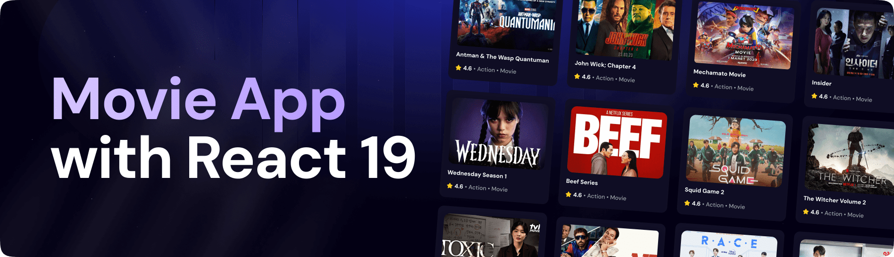

# 🎬 Movie Application

<div align="center">
  <br />
  
  <br />

  <div>
    
    
    
    
  </div>
</div>

## Table of Contents

1. [Introduction](#introduction)
2. [Tech Stack](#tech-stack)
3. [Features](#features)
4. [Quick Start](#quick-start)
5. [Assets](#links)

## Introduction

A modern, responsive movie discovery application built with **React.js**, **Appwrite**, and **Tailwind CSS**, powered by the **TMDB API**.

The application allows users to browse movies, search for specific titles, and discover trending movies through a dynamic trending algorithm.

The project focuses on building reusable React components, managing application state, integrating external APIs, and creating a responsive user experience.

## Tech Stack

- **[React.js](https://react.dev/)** is a JavaScript library for building user interfaces using reusable components and declarative UI development.

- **[Appwrite](https://appwrite.io/)** is an open-source Backend-as-a-Service (BaaS) platform that provides APIs for managing databases, authentication, storage, and other backend services.

- **[React-use](https://github.com/streamich/react-use)** is a collection of reusable React hooks that simplify common tasks such as state management, side effects, and lifecycle operations.

- **[Tailwind CSS](https://tailwindcss.com/)** is a utility-first CSS framework for building responsive and customizable user interfaces.

- **[Vite](https://vite.dev/)** is a modern frontend build tool that provides a fast development environment, hot module replacement (HMR), and optimized production builds.

- **[TMDB API](https://developer.themoviedb.org/docs/getting-started)** provides movie information, including titles, descriptions, ratings, posters, and trending content.

## Features

- **Browse Movies:** Explore a collection of movies available through the TMDB API.

- **Search Movies:** Search for specific movies by title.

- **Trending Movies Algorithm:** Discover trending movies based on search activity.

- **Modern UI/UX:** A clean, modern, and user-friendly interface.

- **Responsive Design:** Optimized for different screen sizes and devices.

- **Reusable Components:** Maintainable component-based architecture.

- **API Integration:** Fetch and manage movie data using external APIs.

- **Backend Integration:** Appwrite integration for storing and retrieving trending movie data.

## Quick Start

Follow these steps to set up the project locally on your machine.

### Prerequisites

Make sure you have the following installed:

- [Git](https://git-scm.com/)
- [Node.js](https://nodejs.org/)
- [npm](https://www.npmjs.com/)

### Cloning the Repository

```bash
git clone https://github.com/Abdullah-Almsaodi/react-movies-platform.git

cd react-movies-platform
```

### Installation

Install the project dependencies:

```bash
npm install
```

### Set Up Environment Variables

Create a new file named `.env.local` in the root directory of your project and add the following environment variables:

```env
VITE_API_KEY=

VITE_APPWRITE_ENDPOINT=
VITE_APPWRITE_PROJECT_ID=
VITE_APPWRITE_DATABASE_ID=
VITE_APPWRITE_TABLE_ID=
```

Replace the placeholder values with your actual credentials:

- [TMDB API](https://developer.themoviedb.org/reference/intro/getting-started)
- [Appwrite](https://appwrite.io/)

### Running the Project

Start the development server:

```bash
npm run dev
```

Open [http://localhost:5173](http://localhost:5173) in your browser to view the application.

## Assets

The project uses assets stored in the `public` directory.

Make sure the required images and resources are available locally:

- `public/readme/hero.png`
- `public/hero-bg.png`
- Other application assets used by the components.
